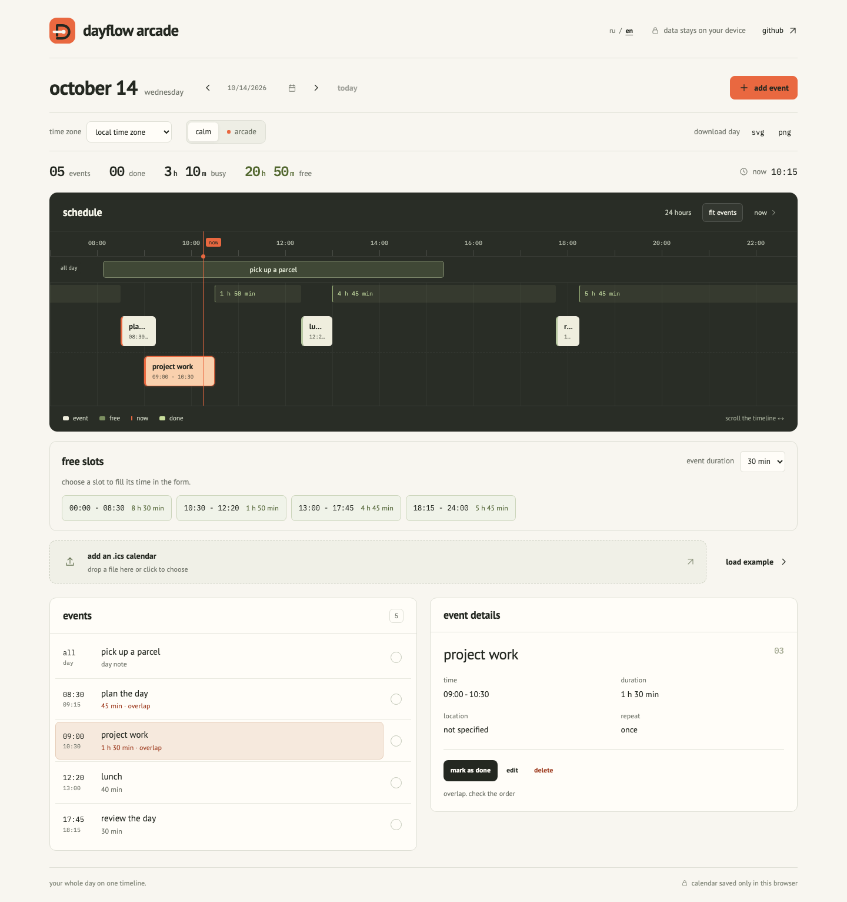
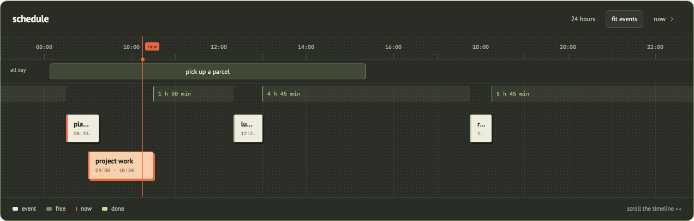
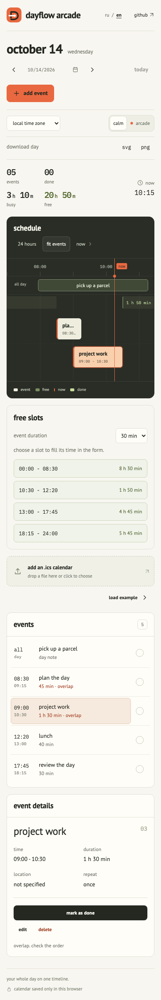
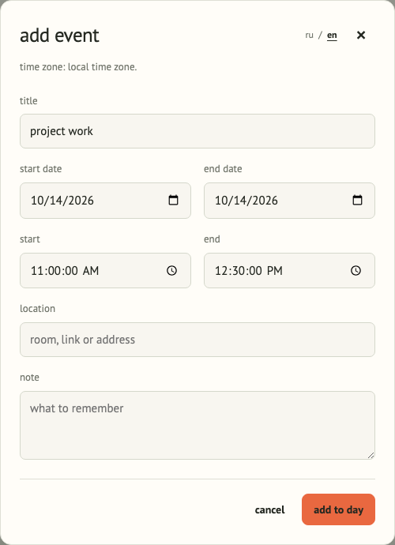

<p></p>

# dayflow arcade

english · [русский](README.ru.md)

your whole day on one timeline. import a calendar, see free slots and put together a schedule you can read at a glance.

**[open the calendar ↗](https://chebaturkin.github.io/dayflow-arcade/?lang=en)** · [run locally](#run-locally) · [checks](#checks) · [русская версия](https://chebaturkin.github.io/dayflow-arcade/?lang=ru)



## using the calendar

choose a day and import an `.ics` file from your calendar. events appear on the timeline and in the list below. select one to see its details, edit its time or mark it as done. “load example” gives you a sample day.

- move between days with arrows, choose a date or return to today.
- fit the whole day or its events into view, or jump to the current time.
- create an event from a free slot with a 30, 60 or 90 minute duration.
- add, edit and delete events, and undo the last action.
- choose a time zone and calm or arcade mode.
- download the schedule and event list as svg or png.

editing or deleting a recurring event affects only the selected occurrence. its neighbors stay in the calendar. the form uses the selected time zone and supports ending on the next date.

choose a duration under “free slots” and select a suitable interval. its start and end appear in the form; add a title and save. you can also select a slot on the timeline. an end at 24:00 becomes 00:00 on the next date.

all day notes have their own row and do not occupy hours in the metrics. overlapping events have separate lanes. busy time uses merged intervals, so overlaps do not count the same hours twice.

the **ru / en** control changes the interface, demo labels, dates and export captions without reloading. direct `?lang=ru` and `?lang=en` links take priority over the saved choice, the first supported browser preference and english. your calendar text and unfinished form remain yours.

## two modes

calm mode keeps the emphasis on the schedule. arcade adds a dotted texture, crisp cards and a completion mark that flies toward the done counter when both are visible. both modes have short transitions and button feedback. your system's reduced motion preference disables animations.

<details>
<summary>arcade mode, mobile screen and event form</summary>


<p></p>


</details>

## data stays with you

the calendar is parsed in your browser. events, completion marks, mode and time zone are saved in `localStorage`; the language choice has a separate key. calendar files and data are never uploaded. there are no accounts, external api calls or server database.

an import replaces the event source; you can undo the last action. data belongs to this browser: clearing site data removes the saved calendar. there is no sync with the original calendar. after loading, the app makes no network requests, but opening or reloading the published page needs a connection: there is no service worker yet.

## run locally

no build or dependency installation is needed for the app:

```bash
python3 -m http.server 4173
```

open [localhost:4173](http://localhost:4173). `file://` cannot run the app because browsers block modules loaded directly from a local file.

## calendar support

imports support utc, `TZID`, floating times, all day events, `DURATION`, `EXDATE` and `DAILY` / `WEEKLY` recurrence. unsupported rules appear in a message. an invalid file does not erase saved events. file size limit: 2 mb.

changes to individual occurrences are stored locally; reimporting replaces them with file data. editing an entire series and importing `RECURRENCE-ID` exceptions are not supported yet. all day notes can be completed or deleted, but their date editor is not implemented.

## checks

core tests need node.js:

```bash
node --test tests/*.test.*
node --check js/app.js
node --check js/calendar-core.js
node --check js/motion.js
```

browser tests need python with playwright and chromium. keep the local server running, then run:

```bash
DAYFLOW_BASE_URL=http://127.0.0.1:4173 python3 tests/browser_smoke.py
DAYFLOW_BASE_URL=http://127.0.0.1:4173 python3 tests/calendar_usability.py
DAYFLOW_BASE_URL=http://127.0.0.1:4173 python3 tests/browser_motion.py
DAYFLOW_BASE_URL=http://127.0.0.1:4173 node tests/i18n-browser.cjs
```

checks cover imports, creation and editing, completion, undo, day navigation, legacy data, two tabs, exports, free slots, recurrence, time zones, motion and both languages. readme screenshots come from the running application with demo data. update both language sets with:

```bash
DAYFLOW_BASE_URL=http://127.0.0.1:4173 python3 tests/capture_screenshots.py
```

## publication

[github pages](https://chebaturkin.github.io/dayflow-arcade/) updates after changes reach `main`. the workflow is [`.github/workflows/pages.yml`](.github/workflows/pages.yml). for your own repository, select **github actions** in **settings → pages**.

## project structure

- `index.html`: interface and accessible controls.
- `styles.css`: styling, responsive layout and motion.
- `i18n.js`: local interface messages and language selection.
- `js/app.js`: state, event list, imports and exports.
- `js/motion.js`: selection, completion and event movement animations.
- `js/calendar-core.js`: calendar parsing, recurrence, overlaps and free slots.
- `assets/logo.svg`: the day loop and current time mark.
- `assets/fonts/`: local fonts and licenses.

inspirations, reviewed implementations, licenses and design decisions are in the [research notes](docs/research/2026-10-14-calendar-improvements.md).
