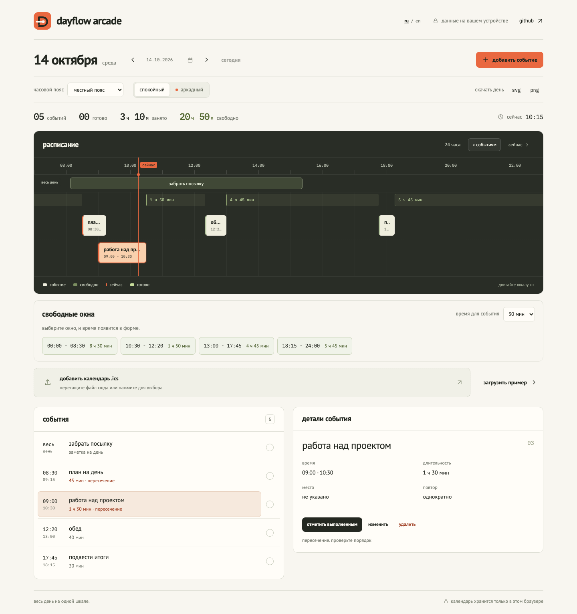
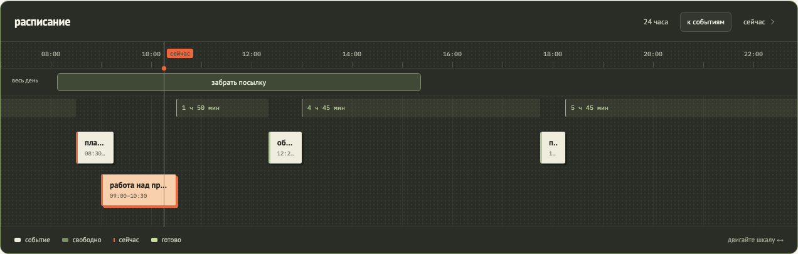
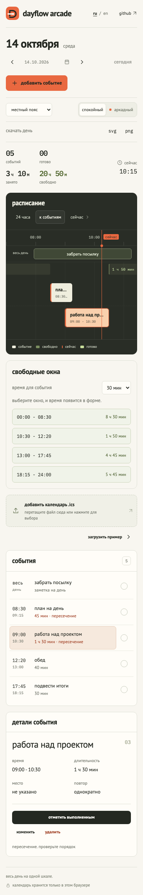
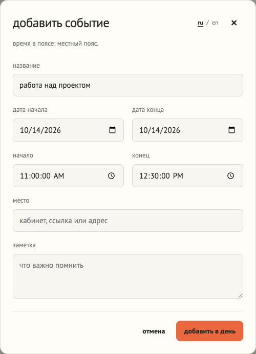

[english](README.md) · русский

<p>
  
</p>

# dayflow arcade

весь день на одной шкале. загрузите календарь, посмотрите свободные окна и соберите расписание, которое удобно читать.

**[открыть календарь ↗](https://chebaturkin.github.io/dayflow-arcade/?lang=ru)** · [запустить локально](#запустить-локально) · [проверить проект](#проверить-проект)



## как это работает

выберите день и загрузите файл `.ics` из своего календаря. события появятся на временной шкале и в списке под ней. нажмите на запись, чтобы посмотреть детали, изменить время или отметить её выполненной. для знакомства есть кнопка «загрузить пример».

- переходите между днями стрелками, выбирайте дату или возвращайтесь к сегодняшнему дню;
- смотрите весь день, приближайте события и переходите к текущему моменту;
- создавайте запись из свободного окна, выбрав длительность 30, 60 или 90 минут;
- добавляйте события вручную, редактируйте, удаляйте и отменяйте последнее действие;
- выбирайте часовой пояс, спокойный или аркадный режим;
- скачивайте расписание и список событий в svg или png.

изменение или удаление повторяющегося события касается выбранного экземпляра, соседние повторения остаются в календаре. форма показывает время в выбранном часовом поясе и позволяет задать конец на следующую дату.

чтобы добавить запись в свободное время, выберите длительность в блоке «свободные окна» и нажмите на подходящий промежуток. начало и конец появятся в форме; останется указать название и сохранить. окно можно выбрать и на шкале. если конец приходится на 24:00, форма покажет 00:00 следующего дня.

заметки на весь день идут отдельной строкой и не занимают часы в статистике. пересекающиеся события занимают разные ряды; занятое время считается по объединённым интервалам, поэтому пересечения не удваивают часы.

## два режима

спокойный режим оставляет акцент на расписании. аркадный добавляет точечную фактуру, чёткие карточки и отметку выполнения, которая летит к счётчику «готово», когда оба элемента видны на экране. короткие переходы и отклик кнопок есть в обоих режимах; системная настройка уменьшения движения отключает анимации.

<details>
<summary>аркадный режим, мобильный экран и добавление события</summary>



<p></p>



</details>

## данные остаются у вас

календарь разбирается в браузере. события, отметки, режим и часовой пояс сохраняются в `localStorage`. файлы и данные календаря никуда не отправляются. регистрации, внешнего api и серверной базы данных нет.

импорт заменяет источник событий; последнее действие можно отменить. данные доступны в текущем браузере: очистка данных сайта удалит сохранённый календарь. синхронизации с исходным календарём нет. после загрузки приложение работает без сетевых запросов, но для первого открытия и перезагрузки опубликованной страницы нужна сеть: service worker пока нет.

## запустить локально

сборка и установка зависимостей для приложения не нужны:

```bash
python3 -m http.server 4173
```

откройте [localhost:4173](http://localhost:4173). запуск через `file://` не подходит: браузер блокирует es-модули из локального файла.

## поддержка календарей

импорт понимает utc, `TZID`, время без часового пояса, записи на весь день, `DURATION`, `EXDATE` и повторения `DAILY` / `WEEKLY`. неподдерживаемые правила показываются в сообщении; ошибочный файл не стирает сохранённые события. предел размера файла: 2 мб.

правки отдельных повторений сохраняются локально; повторный импорт заменяет их данными файла. изменение всей серии и импорт исключений `RECURRENCE-ID` пока не поддерживаются. заметки на весь день можно отметить или удалить, редактор их дат не добавлен.

## проверить проект

для тестов ядра нужен node.js:

```bash
node --test tests/*.test.mjs
node --check js/app.js
node --check js/calendar-core.js
node --check js/motion.js
```

для браузерной проверки нужен python с playwright и chromium. оставьте локальный сервер на порту `4173`, затем выполните:

```bash
python3 tests/browser_smoke.py
python3 tests/calendar_usability.py
python3 tests/browser_motion.py
```

проверка проходит импорт, создание и редактирование, отметки выполнения, отмену, переходы между днями, сохранение старых данных, две вкладки, экспорт и мобильную ширину. отдельные проверки проходят свободные окна, повторения, часовые пояса и анимации. скриншоты readme сняты с работающего приложения на демонстрационных данных; их можно обновить командой:

```bash
python3 tests/capture_screenshots.py
```

## публикация

[github pages](https://chebaturkin.github.io/dayflow-arcade/?lang=ru) обновляется после отправки изменений в `main`. workflow находится в [`.github/workflows/pages.yml`](.github/workflows/pages.yml). для своего репозитория выберите **github actions** в **settings → pages**.

## устройство проекта

- `index.html`: интерфейс и доступные элементы управления;
- `styles.css`: оформление, адаптивная сетка и анимации;
- `js/app.js`: состояние, список событий, импорт и экспорт;
- `js/motion.js`: анимации выбора, выполнения и перемещения записей;
- `js/calendar-core.js`: разбор календаря, повторения, пересечения и свободные окна;
- `assets/logo.svg`: авторский знак: петля дня и точка текущего момента;
- `assets/fonts/`: локальные шрифты и сведения об их лицензиях.

источники идей, изученные реализации, лицензии и выбор улучшений собраны в [исследовании аналогов](docs/research/2026-10-14-calendar-improvements.md).
